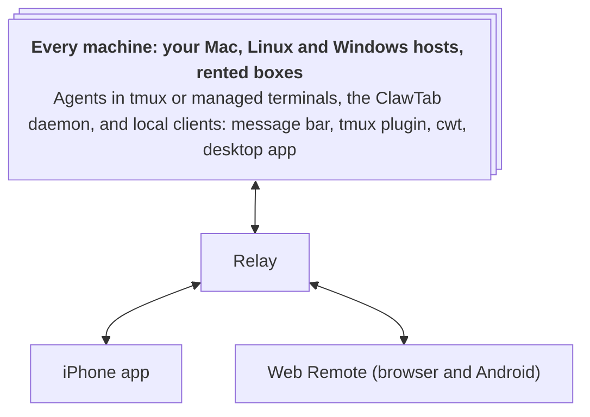

<h3 align="center">ClawTab: manage all your coding agents from one place</h3>

ClawTab connects Claude Code, Codex, OpenCode, and Hermes in one workspace. The agents keep running in their own terminals, and a background daemon tracks what each one is doing and whether it needs you. Apps for macOS, iPhone, and the web, plus hosts for Linux and Windows, let you answer an agent and continue its session from wherever you are.

<p align="center">
  <a href="https://cdn.clawtab.cc/assets/home/message-bar-hero-v12e-narrated.mp4">
    
  </a>
</p>

[Website](https://clawtab.cc) · [Documentation](docs/) · [Release notes](docs/release-notes.md)

## What you get

- [Message bar](docs/messages.md): questions, permission prompts, and updates from every agent in one macOS bar. Reply from the card or jump to the session.
- [Phone and web](docs/remote.md): live terminal, push notifications, and one-tap answers on iPhone and in the browser.
- [Tmux plugin](docs/tmux.md): working, waiting, and idle markers in your status bar, and panes named after their task.
- [Scheduled jobs](docs/job-types.md): run agents on a cron schedule or once at a set time, with optional auto-yes for unattended runs.
- [`cwt` CLI](docs/cli-tui.md): start, follow, and control agents and jobs from the terminal.
- [Sessions without tmux](docs/managed-sessions.md): keep agents alive on macOS, Linux, and Windows without tmux.
- [Desktop app and Mind Map](https://clawtab.cc/articles/mind-map): optional split workspaces and a map of your running agents.
- Also: [secrets](docs/secrets.md), [Telegram](docs/telegram.md), and [workspace sharing](docs/sharing.md).

## How it fits together



The daemon runs in the background and doesn't need the desktop app open. Every client (tmux, `cwt`, desktop, phone) connects to the same session, so switching devices never restarts or duplicates an agent. Your Mac and any remote machines run the same daemon and connects to the same relay, so agents on all of them show up in one place. More in [Remote machines](docs/remote-machines.md) and [Architecture](docs/architecture.md).

## Install

| Platform | Get it |
| --- | --- |
| macOS | `brew install --cask tonisives/tap/clawtab` (daemon and CLI)<br>`brew install --cask tonisives/tap/clawtab-desktop` (optional desktop app) |
| Linux | [x86_64](https://github.com/tonisives/clawtab/releases/latest/download/clawtab-linux-x86_64.tar.gz) / [ARM64](https://github.com/tonisives/clawtab/releases/latest/download/clawtab-linux-aarch64.tar.gz) |
| Windows | Native host and CLI, no WSL. See [platform builds](docs/platform-builds.md#windows). |
| iPhone / iPad | [App Store](https://apps.apple.com/us/app/clawtab/id6759683841) |
| Android | [remote.clawtab.cc](https://remote.clawtab.cc) in your browser. Play Store app coming soon. |
| Web | [remote.clawtab.cc](https://remote.clawtab.cc) |

On macOS, start the daemon after installing:

```sh
cwt daemon install
cwt daemon status
```

You need tmux (or [managed sessions](docs/managed-sessions.md)) and at least one agent CLI. To build from source, see [Quick Start](docs/quick-start.md) and [platform builds](docs/platform-builds.md).

## FAQ

**Why not just use tmux?** You still do. ClawTab adds the agent-aware parts on top: status, task titles, question detection, schedules, notifications, and phone access. Remove it and your tmux setup is unchanged.

**Do I need the desktop app open?** No. The daemon handles everything in the background.

**Does it replace Claude Code or Codex?** No. It runs them side by side so you can pick the right provider, or subscription, for each task.

**What does it cost?** The apps and local tools are free and MIT licensed. You can self-host the relay or pay for the hosted [Remote](https://clawtab.cc/remote).

## License

[MIT](./LICENSE)
