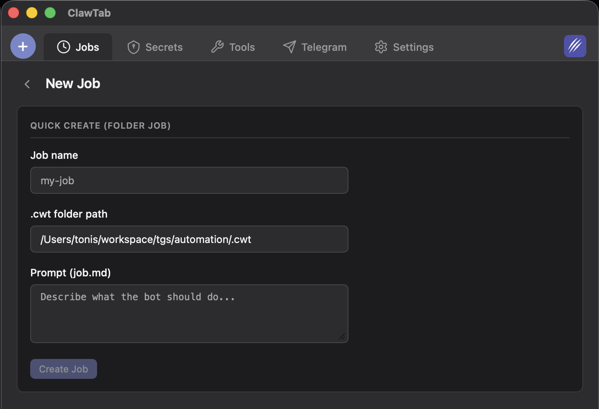

# Quick Start

## Prerequisites

- macOS
- Your provider CLI: Claude Code, Codex, or OpenCode
- [tmux](https://github.com/tmux/tmux) for tmux sessions; optional for managed sessions

For Linux or Windows hosts, follow [platform installation](platform-builds.md).

## Installation

### Homebrew (recommended)

```bash
brew install --cask tonisives/tap/clawtab
```

This installs the headless daemon, `cwtctl`, agent hooks, and Zsh completion. Start the background service:

```sh
cwtctl daemon install
cwtctl daemon ping
```

For split workspaces, the Mind Map, and visual settings, install the optional desktop app:

```sh
brew install --cask tonisives/tap/clawtab-desktop
```

Launch the desktop app with `cwt`. Starting with the next release, Homebrew
installs `cwt` as the desktop shell command in place of `clawtab`. The app name
remains ClawTab, and `cwtctl` continues to provide CLI commands.

### Build from source

```bash
pnpm install
cargo tauri build
```

Source builds can produce these binaries:

| Binary | Purpose |
|--------|---------|
| `clawtab-daemon` | Headless scheduler, agent monitor, and Remote host |
| `clawtab` | GUI app (Tauri window) |
| `cwtctl` | CLI for headless control |
| `cwttui` | Terminal UI (ratatui) |

## Start an agent from your terminal

ClawTab 0.6 can run agents without tmux. In your project directory:

```sh
cwtctl session start -- codex
```

Use `claude` or `opencode` for another provider. The agent keeps running when you close the terminal. Press Ctrl+] then d to detach, and use `cwtctl session list` followed by `cwtctl session attach <id>` to reconnect. Pair the host with `cwtctl setup` to see it in Remote.

See [sessions without tmux](managed-sessions.md) for control, shutdown, and recovery options, and the [0.6.0 release notes](release-notes.md) for the full update.

## Setup Wizard

On first launch of the optional desktop app, the setup wizard walks through:

1. **Tools** -- Detects installed tools (editors, terminals, tmux, claude, gopass, aerospace)
2. **Notifications** -- Choose notification target: ClawTab App (push), Telegram (bot), or skip
3. **Hello World** -- Creates and runs a test job to verify the setup
4. **Web Browse** -- Creates an AI job that fetches Hacker News
5. **Done** -- Saves `settings.yaml`, marks setup complete

The wizard auto-detects tools and shows version + path for each. Missing tools can be installed via Homebrew directly from the UI.

## Creating Your First Job



### Binary job (run a script)

1. Open the Jobs panel
2. Click "New Job"
3. Set type to **Binary**
4. Set path to your script (e.g., `/path/to/backup.sh`)
5. Choose a weekly calendar recurrence or set a cron expression (e.g., `0 0 * * *` for daily at midnight)
6. Save

### Claude job (run a prompt)

1. Set type to **Claude**
2. Set path to a text file containing your prompt
3. The prompt file content is passed to `claude` via `$(cat /path/to/prompt.txt)`
4. Runs inside a tmux window named `cwt-<project>`

### Folder job (project-based AI agent)

1. In ClawTab, click "New Job" and set type to **Folder**
2. Browse to your project root
3. Enter a **Job Name** (e.g., "deploy", "lint")
4. Edit `job.md` with your agent instructions (stored at `~/.config/clawtab/jobs/<slug>/<job-name>/job.md`)
5. Optionally add shared context in `~/.config/clawtab/jobs/<slug>/context.md` (applies to all jobs in the project)
6. The job runs Claude from the project root with context inlined from central config

All job files (config, prompts, context) are stored centrally at `~/.config/clawtab/jobs/`.

### Scheduled agent job from the CLI

In a project directory, run `cwtctl jobs create` for an interactive form. Enter the name and a cron expression or one-time date, then write the job description in `nvim`. The command joins the nearest configured group whose project folder contains the current directory. If none matches, it creates a group from the directory name.

You can also supply the fields directly:

```bash
cwtctl jobs create --name daily-review --cron '0 9 * * *' --description-file review.md
cwtctl jobs create --name follow-up --at '2026-10-02 09:00' --description 'Check the results'
cat task.md | cwtctl jobs create --name task --at '2026-10-02T09:00:00+07:00' --description-stdin
```

`--at` takes a future local date and time or RFC 3339 timestamp. A one-time job removes its config after the agent starts by default, while the tmux pane and run history remain available. Pass `--keep-config` to retain a disabled job. See [CLI & TUI](cli-tui.md) for details.

## Running a Job

- **GUI**: Click "Run Now" on any job
- **CLI**: `cwtctl jobs run <group>/<name>`
- **TUI**: Select job, press `r`
- **Telegram**: Send `/run <name>` to your bot
- **Schedule**: Automatically triggered by the job's cron expression, calendar recurrence, or one-time date

## Checking Status

```bash
cwtctl jobs status
```

Status values: `idle`, `running`, `success`, `failed`, `paused`.
